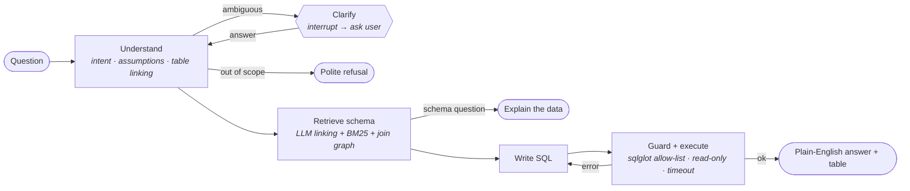

# Ask the Warehouse: multi-agent text-to-SQL

**Live demo: https://frontend-flame-seven-10.vercel.app**. Try *"Who are our best customers?"* to see it ask
a clarifying question.

Business users ask questions in plain English, such as *"Who were our best customers last year?"*, and get answers
from a complex retail data warehouse without knowing SQL. A LangGraph workflow of specialised agents works out
what they mean, asks when something is genuinely ambiguous, finds the right tables among 425 cryptically named
columns, then writes, safety-checks and runs the SQL. Every step streams live to the UI.

**Warehouse:** [TPC-DS](https://www.tpc.org/tpcds/), the industry-standard decision-support schema: 24 tables, 425
columns (`ss_ext_sales_price`, `cd_dep_college_count`, …), snowflake joins, and about 19M rows at scale factor 1.
It scales to billions of rows.

## How it works

New to the code? Start with the plain-language [tour](docs/how-it-works.md), then the
[architecture](docs/architecture.md) and the [data dictionary](docs/data-dictionary.md). Real problems we hit and
how we debugged them are logged in [challenges and fixes](docs/challenges-and-fixes.md).



| Agent / step | What it does |
|---|---|
| **Understand** | Classifies intent, rewrites follow-ups into standalone questions, applies documented defaults (e.g. *"last year" = latest full year in the data*), and links the question to tables. |
| **Clarify** | When a question is ambiguous in a way that changes the answer (*"best" by revenue, orders or profit?*), the graph pauses with a LangGraph `interrupt` and resumes on the user's reply. State lives in a checkpointer, so this works across stateless HTTP requests. |
| **Retrieve** | Two-stage schema linking. The LLM picks tables from a compact catalog overview; BM25 over column descriptions and sample values adds column-level evidence; join-graph bridging adds connecting tables. Only that slice of the schema reaches the SQL writer. |
| **Write SQL** | Generates DuckDB SQL grounded in a **semantic layer**: business descriptions, metric definitions (*revenue = net_paid*), join rules and value domains. |
| **Guard + execute** | Rejects anything but a single read-only query over known tables (sqlglot AST checks), injects row limits, runs on a read-only connection with external access disabled and a timeout. Errors are fed back for self-correction. |

## Evaluation

Answers are scored by comparing query **results** against hand-verified gold SQL (extra columns allowed, numeric
tolerance, order checked only when the question implies it), via `uv run sqlagent eval`.

- **Development evaluation (done):** 63 questions used to find and fix failures. Baseline 77.1% execution
  accuracy with gpt-oss-120b on the free Groq tier. A key finding: every miss was *valid SQL with the wrong
  meaning*, which error-driven retries can't catch. That led to term grounding and other fixes. Details:
  [challenges and fixes](docs/challenges-and-fixes.md) #15–16.
- **Final evaluation (planned):** once the product is complete, the code is frozen and a fresh, unseen test set
  is run across local, Groq and Claude models in one pass, following a
  [protocol written in advance](docs/evaluation-protocol.md). The accuracy-vs-cost table will go here.

## Engineering highlights

- **Semantic layer as code**: a curated YAML glossary is merged with live warehouse introspection (types, value
  domains, date coverage, FK paths derived from naming conventions, since TPC-DS declares no foreign keys) into a
  versioned catalog.
- **Cost-aware, provider-agnostic LLM layer**: each node asks for a *role*, not a provider. The default is free
  open-weight models (Groq, Cerebras, local Ollama) with automatic fallback. Visitors can bring their own Claude
  key per request, and the owner's key is only an opt-in, capped last resort. Every call records the serving
  model and token usage.
- **Defence in depth for LLM-generated SQL**: AST allow-list, read-only connection, locked configuration, no
  filesystem or network access from SQL, statement timeouts and row caps, each covered by tests.
- **Secrets never persisted**: BYO keys travel through LangGraph's runtime context, not `configurable`, which
  LangGraph copies into checkpoint metadata.
- **Tested end to end**: graph and API tests drive the real warehouse with a scripted LLM, covering
  clarification round-trips, self-correction, unsafe-SQL rejection and follow-ups.

## Stack

FastAPI · LangGraph · LangChain · DuckDB / MotherDuck · sqlglot · rank-bm25 · Next.js 16 · React 19 · Tailwind 4,
with Postgres (Neon) for conversation checkpoints.

## Deployment

The live demo runs entirely on free tiers:

| Piece | Service |
|---|---|
| Website (Next.js) | Vercel |
| Backend (FastAPI + LangGraph) | Vercel Python runtime, streaming responses |
| Warehouse (DuckDB) | MotherDuck, read-only token + `saas_mode` |
| Conversation state for paused clarifications | Neon Postgres |
| LLMs | Groq free tier, with Cerebras as an optional backup |

Ollama is used for local development only. Step-by-step setup, verification and troubleshooting:
[docs/deployment.md](docs/deployment.md).

## Run it locally

Prerequisites: Python 3.12 with [uv](https://docs.astral.sh/uv/), Node 20+, and either a free
[Groq API key](https://console.groq.com/keys) or [Ollama](https://ollama.com).

```bash
# Backend
cd backend
uv sync
uv run sqlagent generate-data --sf 1     # ~5 s, builds data/tpcds_sf1.duckdb
cp .env.example .env                     # add GROQ_API_KEY and/or OLLAMA_BASE_URL
uv run sqlagent ask "What were the top 5 product categories by revenue in 2002?"
uv run sqlagent serve                    # http://localhost:8000

# Frontend (second terminal)
cd frontend
npm install
cp .env.local.example .env.local
npm run dev                              # http://localhost:3000
```

Tests: `cd backend && uv run pytest`.

## Roadmap

- [x] Evaluation harness with a TPC-DS gold set (baseline 77.1%)
- [x] Development evaluation and a first round of fixes for semantic failure modes
- [ ] Final evaluation on a fresh test set at code freeze ([protocol](docs/evaluation-protocol.md))
- [ ] Accuracy-vs-cost comparison across Claude models; BIRD benchmark
- [ ] Semantic cache of verified question → SQL pairs (pgvector)
- [x] Hosted demo: Vercel (UI + API) + MotherDuck (warehouse) + Neon (checkpoints)
- [ ] Backup LLM provider in production (Cerebras) and a semantic cache to stretch the free quota
- [ ] Automatic charts, an `EXPLAIN` dry-run validator, and a planner for multi-step questions

## License

MIT
