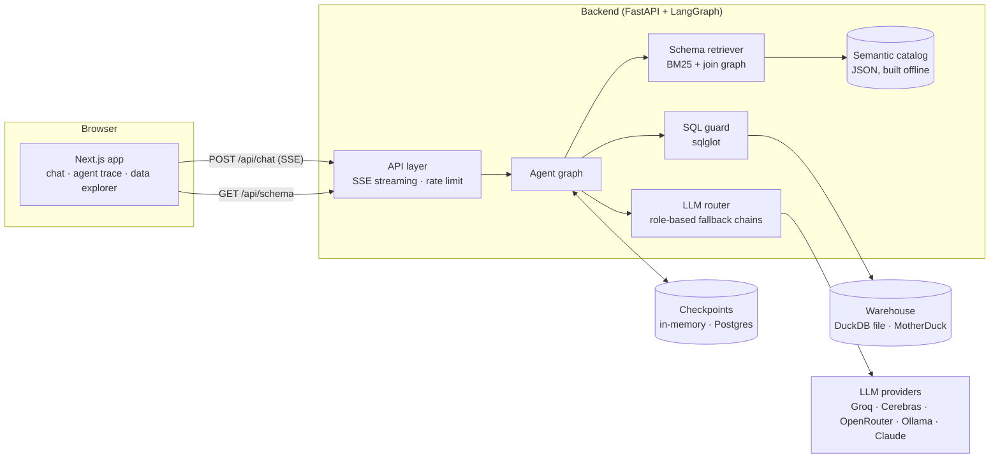
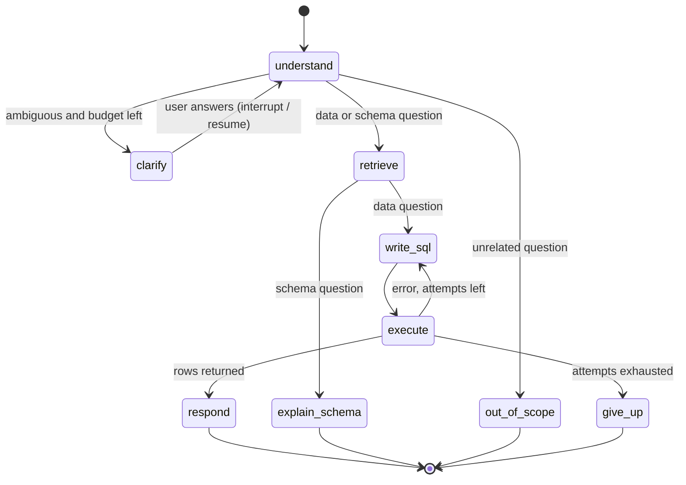
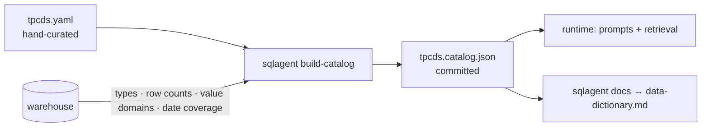

# Architecture

How *Ask the Warehouse* turns a plain-English question into a verified answer: the components, the agent
workflow, the data flow, and the reasoning behind the main design decisions. For the database itself, see the
[data dictionary](data-dictionary.md).

**Status (v1):** the backend and frontend run locally and are tested end to end. Hosting, the evaluation
harness and the semantic cache are planned (see [Roadmap](#roadmap)).

## 1. Problem and constraints

Non-technical users need answers from a warehouse they can't navigate: 24 tables, 425 columns with names like
`cs_ext_discount_amt`, no declared foreign keys, and business meaning that lives only in people's heads
("revenue" is `net_paid`, not `sales_price`). The system has to:

- Understand intent and **ask** when a question is genuinely ambiguous, rather than guess.
- Find the few relevant tables without sending the whole schema to the model.
- Never let generated SQL modify data or reach outside the warehouse.
- Run on **free tiers only**, with paid models strictly opt-in.
- Show its work: every step is visible to the user.

## 2. System overview

| Layer | Technology | Location |
|---|---|---|
| UI | Next.js 16 (App Router), React 19, Tailwind 4 | `frontend/` |
| API | FastAPI, sse-starlette | `backend/src/sqlagent/api/` |
| Orchestration | LangGraph (StateGraph, interrupts, checkpointer) | `backend/src/sqlagent/graph/` |
| LLM access | LangChain chat models (Groq, OpenAI-compatible, Ollama, Anthropic) | `backend/src/sqlagent/llm.py` |
| Schema knowledge | Curated YAML merged with introspection into JSON | `backend/semantic/`, `backend/src/sqlagent/semantic/` |
| Retrieval | rank-bm25 + join-graph BFS | `backend/src/sqlagent/retrieval.py` |
| SQL safety | sqlglot AST checks + DuckDB configuration | `backend/src/sqlagent/db/` |
| Warehouse | DuckDB (local file) / MotherDuck (hosted, planned) | `backend/data/` (gitignored) |

## 3. The agent workflow

| Node | Model role | Responsibility |
|---|---|---|
| `understand` | router | Classify intent; rewrite follow-ups into a standalone question; apply and record default assumptions; pick candidate tables from a ~1k-token catalog overview; decide whether to ask a clarifying question. |
| `clarify` | none | Pause the graph with `interrupt()` and return the question plus suggested options. The user's reply resumes the same node with `Command(resume=...)`. |
| `retrieve` | none | Two-stage schema linking (§5) that produces the table slice for the SQL writer. |
| `write_sql` | sql | Write DuckDB SQL from the rendered schema slice, metric definitions, join rules and assumptions. On retry it sees the previous SQL and the error. |
| `execute` | none | Guard, then run (§6). On failure, record the error and route back to `write_sql` (up to `MAX_SQL_ATTEMPTS`, default 3). |
| `respond` | router | Summarise the results in plain English from the question, SQL and the first 30 rows. |
| `explain_schema` | router | Answer "what data do you have about X?" from catalog documentation. |
| `out_of_scope`, `give_up` | none | Fixed responses. No LLM cost. |

**Design choice:** the graph is a fixed workflow with LLM decisions at defined points, not a free-roaming agent
with tools. Text-to-SQL has a known shape (understand, ground, generate, verify), and a fixed graph makes
behaviour predictable, testable with a scripted model, and cheap: 3–4 model calls per question.

### State

`AgentState` (`graph/state.py`) is one TypedDict per conversation thread:

- **Persisted across turns:** `history` (question, SQL, answer), which feeds follow-up questions.
- **Per turn**, reset by `new_turn()` at the start of each question: `question`, `clarifications`,
  `pending_clarification`, `intent`, `standalone_question`, `linked_tables`, `assumptions`, `tables`, `sql`,
  `attempts`, `last_error`, `result`, `answer`, `llm_calls`.

There are no reducers. Nodes that extend a list return `[*old, new]`.

## 4. Semantic layer

The model can't infer that `ss_net_paid` means revenue, or that `d_same_day_ly` holds a date *key*. That
knowledge is captured once, as code:

`tpcds.yaml` holds:
- Table descriptions and business synonyms ("POS transactions", "online orders").
- Column meanings, resolved in this order: exact override, then a shared suffix pattern (e.g. every
  `*_net_paid`), then abbreviation expansion.
- `dimension_keys`, which derive join paths from `*_sk` naming because TPC-DS declares no foreign keys.
- Metric definitions and join rules.

The builder adds what can be measured: types, row counts, the full value list for columns with 40 or fewer
distinct values (so filters use exact spellings like `'4 yr Degree'`), and per-fact date coverage (so "last
year" resolves to 2002, not to today).

The catalog is committed, so serving a request never introspects the warehouse. That matters on MotherDuck,
where every query spends free compute-hours.

## 5. Schema retrieval (two-stage linking)

Sending all 425 columns to the model costs tokens and reduces accuracy. Retrieval picks a connected slice of
tables:

1. **LLM linking (recall on meaning).** `understand` sees one line per table and names the tables it needs. It
   understands that "online" means `web_sales` even though the strings don't overlap.
2. **BM25 (recall on detail).** A lexical index over table and column documents (name, description, sample
   values, synonyms) catches column-level evidence the overview can't show, such as "TV" matching
   `p_channel_tv`. A BM25 hit is kept only if it is among the top 3, scores at least 60% of the best score, and
   **joins directly to an LLM-linked table**. Unrelated lexical matches, such as every table with a `state`
   column, are dropped rather than bridged in.
3. **Join-graph completion.** Breadth-first search over the FK graph adds bridge tables (e.g.
   `household_demographics` between `store_sales` and `income_band`). `date_dim` and `time_dim` are excluded as
   bridges because they connect to almost everything, which would produce meaningless joins. `date_dim` is
   added whenever a fact table is selected.

If the LLM links nothing (or fails), BM25 top-k alone is used. `SchemaRetriever` is the place to swap in
embeddings (pgvector) for warehouses with hundreds of tables.

## 6. SQL safety: defence in depth

Generated SQL is treated as untrusted input. Four independent layers each block a different failure:

| Layer | Mechanism | Blocks |
|---|---|---|
| 1. AST allow-list (`db/guard.py`) | sqlglot parse, exactly one statement, root must be a query | DML/DDL, `ATTACH`, `PRAGMA`, `COPY`, `SET`, `INSTALL`, multi-statement injection |
| | Forbidden functions | `read_csv`/`read_parquet`/`glob`/`getenv`/`duckdb_*()`, i.e. file, network and environment access |
| | Table allow-list (CTE names excepted), no qualified names | Other databases and system tables |
| | `LIMIT` injected or clamped to `max_result_rows + 1` | Huge result sets (the +1 detects truncation) |
| 2. Connection (`db/warehouse.py`) | `read_only=True`, `enable_external_access=false`, `lock_configuration=true` passed at connect | Writes and filesystem/network access, even if layer 1 had a bug, and re-enabling either from SQL |
| 3. Execution | Timer calls `cursor.interrupt()` after `query_timeout_s` | Runaway queries burning compute |
| 4. Credentials (hosted) | MotherDuck read-scaling token | Writes at the service level |

Each layer has tests, including tests that bypass the guard and hit the raw connection.

## 7. LLM provider layer

Nodes ask for a **role** (`router` or `sql`), never a provider. `LLMRouter` resolves the role to an ordered
chain from configuration (`ROUTER_MODELS`, `SQL_MODELS`), skips providers without credentials, and moves to the
next model on any error: rate limit, quota, timeout, or unparseable output.

| Situation | Chain order |
|---|---|
| Default | free open models (e.g. Groq gpt-oss-120b → Cerebras → local Ollama) |
| Visitor supplied their own Anthropic key | **Claude first** (that request only), then open models |
| SQL failed twice (escalation) and a Claude key is available | **Claude first** |
| Owner key enabled (`OWNER_ANTHROPIC_ENABLED=true`) | open models, then Claude as last resort |

- **Three-phase fallback:**
  1. Hosted models in chain order, with SDK retries disabled so a failure moves on immediately.
  2. If every hosted model was rate-limited (HTTP 429) and the shortest provider-reported wait is at most
     `MAX_RATE_LIMIT_WAIT_S` (20 s), wait once and retry those models.
  3. Local models (Ollama), which are slow on consumer GPUs, last.

  Every switch and wait is streamed to the client as a `notice` event. Free tiers limit tokens *per minute
  per model* (about 8k for gpt-oss-120b on Groq), and the SQL prompt is about 3.8k tokens, so this path is
  routine, not exceptional.
- **Own fallback loop** instead of LangChain's `.with_fallbacks()`, so every call records which model actually
  served it, which models failed first, and the token usage (`CallRecord`). The UI shows this per step, and the
  evaluation harness will use it for cost-per-question.
- **Structured output via `method="json_schema"` for every provider.** `ChatAnthropic` defaults to function
  calling, which forces `tool_choice`, and current Claude models reject that with a 400.
- **No sampling parameters** (`temperature` etc.), because current Claude models reject them.
- **BYO keys** are validated by prefix, used for one request, never cached, logged or persisted (see §8).

## 8. State, persistence and secrets

- **Checkpointer:** `InMemorySaver` locally; `AsyncPostgresSaver` when `DATABASE_URL` is set (Neon, planned).
  Persistence is what lets a clarification pause in one HTTP request and resume in the next.
- **Thread model:** the client holds a `thread_id`. On each `POST /api/chat`, the API checks whether the thread
  is paused on an interrupt. If so, the message resumes it; otherwise it starts a new turn.
- **Secrets never enter the checkpoint.** LangGraph copies string values from `config["configurable"]` into
  checkpoint metadata, so a key passed there would land in Postgres. BYO keys travel through LangGraph's runtime
  context (`context=RunContext(...)`), which is not persisted. In the browser the key lives only in
  `sessionStorage`.

## 9. API contract

| Endpoint | Purpose |
|---|---|
| `POST /api/chat` | Body `{message, thread_id?}`, optional header `X-Anthropic-Key`. Returns `text/event-stream`. |
| `GET /api/schema` | Tables, columns, descriptions and coverage for the data explorer. |
| `GET /api/health` | Liveness plus which models are configured per role. |

SSE events, in order:

| Event | Payload | Emitted when |
|---|---|---|
| `thread` | `thread_id` | Always first |
| `step` | per-node summary (intent, assumptions, tables, SQL, retry error, model) | Each node completes |
| `notice` | `{type: "fallback", model, reason}` or `{type: "waiting", seconds}` | A provider failed or is rate-limited |
| `clarification` | `question`, `options[]` | Graph paused for the user |
| `result` | `sql`, `columns`, `rows`, `row_count`, `truncated`, `elapsed_ms` | Query succeeded |
| `answer` | `text`, `llm_calls[]` | Final response |
| `error` | user-safe `message` | Provider exhaustion or internal error; details stay in server logs |
| `done` | none | Always last |

Anonymous requests are rate-limited per IP (`RATE_LIMIT_PER_MINUTE`). BYO-key requests are exempt because they
spend the visitor's own credits.

## 10. Frontend

- `app/page.tsx` (Server Component) renders a single client entry, `components/App.tsx`.
- `lib/api.ts`: a fetch-based SSE parser, because `EventSource` can't POST or send headers.
- `lib/useChat.ts`: conversation state as a list of *runs* (one per question). A clarification reply continues
  the same run on the same thread.
- `lib/keyStore.ts`: the BYO key as an external store (`useSyncExternalStore`), which avoids hydration
  mismatches.
- Components:
  - `AgentTrace`: live step timeline with the serving model per step.
  - `RunView`: clarification chips, SQL, results, answer.
  - `ResultTable`: number formatting and CSV export.
  - `SchemaExplorer`: searchable catalog.
  - `SettingsDialog`: the BYO key.
- Theme: CSS-variable tokens with a dark-mode override in `globals.css`.

## 11. Testing

| Suite | What it proves |
|---|---|
| `test_guard.py` | 19 classes of unsafe SQL rejected; CTEs, unions and joins allowed; LIMIT injection |
| `test_warehouse.py` | The raw connection is read-only, has no file access and locked settings, even bypassing the guard |
| `test_retrieval.py` | Linking keeps relevant tables, drops lexical noise, bridges correctly, never via `date_dim` |
| `test_llm.py` | Chain ordering for default, BYO, escalation and owner key; fallback; usage recording; `json_schema` |
| `test_graph.py` | Full graph on the real SF1 warehouse with a **scripted LLM**: happy path, interrupt/resume, self-correction, unsafe SQL never executed, out of scope, follow-ups, SQL-in-question fallback |
| `test_api.py` | SSE event order, clarification round trip over HTTP, rate limiting, BYO-key validation |
| `test_docs.py` | The data dictionary covers every column and preserves hand-written prose |

Tests never call a real LLM. Model quality is measured separately by the evaluation harness (`sqlagent eval`, §11.1), because
live behaviour varies from run to run. Early live runs with a 20B local model showed misclassification and SQL
leaking into the rewritten question, both now handled.

### 11.1 Evaluation harness

`backend/src/sqlagent/evals/` runs a gold set (`backend/evals/tpcds_gold.yaml`, 41 cases) through the real
graph and writes `evals/runs/<name>/{results.jsonl,summary.json,report.md}`:
- **Scoring:** execution accuracy on results. Every gold column must match a distinct predicted column and the
  rows must line up; extra columns are allowed; numbers match within 0.01; order is checked only when the
  question implies it. A strict variant (no extra columns) is reported too.
- **Infrastructure vs model failures:** cases where every provider was unavailable are recorded as unscored
  and retried on resume, so outages don't count as wrong answers.
- **Economy:** the summary step is skipped (`Deps.summarize=False`); `--pace` spaces requests for free-tier
  limits; `--rescore` re-checks stored SQL after gold fixes without calling an LLM.
- **Baseline (Groq gpt-oss-120b/20b):** 77.1% (27/35), routing 100%. All misses were semantically wrong but
  valid SQL; see challenges log #15.
- **Phases:** the existing sets are development sets. Reportable numbers come only from the final protocol
  ([evaluation-protocol.md](evaluation-protocol.md)): frozen code, a fresh unseen set, every model in one pass.

## 12. Key design decisions

| Decision | Alternatives considered | Why |
|---|---|---|
| TPC-DS as the showcase dataset | IMDb, Olist, MIMIC-IV demo | Enterprise-shaped complexity (24 tables, cryptic names, multi-channel facts), scales with one command, and ships 99 reference queries for evaluation |
| DuckDB / MotherDuck | Postgres (Neon/Supabase), CockroachDB | Columnar engine fit for analytics over millions of rows; largest free tier (10 GB) |
| Fixed graph with LLM decision points | ReAct agent with SQL tools | Predictable, testable, bounded cost; clarification is a first-class state |
| Two-stage linking (LLM + BM25 + graph) | Embeddings only; full schema in prompt | Free and fast with no embedding API; LLM handles meaning, BM25 handles column detail, graph guarantees joinability |
| Semantic layer as YAML + generated catalog | Prompt-embedded notes; DB comments | Reviewable, versioned, testable; one source for prompts, retrieval and docs |
| Own fallback loop | `Runnable.with_fallbacks` | Per-call attribution and usage for the UI and cost evaluation |
| SSE over POST | WebSockets; polling | One-way streaming is all that's needed; plain HTTP works on serverless platforms |
| Clarify via `interrupt` + checkpointer | Client-side multi-turn prompt stuffing | The graph resumes exactly where it paused, with full state, across requests |

## 13. Known limitations

- **Rate limiting is per process.** It is correct on one instance, but multiple serverless instances need a
  shared store.
- **The in-memory checkpointer loses conversations on restart.** `DATABASE_URL` fixes this.
- **Small local models (20B) are slow on a 12 GB GPU** (~2 min per question with CPU offload) and less
  reliable. Hosted gpt-oss-120b (Groq) is the intended default.
- **The result preview sent to the summariser is the first 30 rows.** Answers about long results describe that
  preview.
- **The retrieval thresholds** (top-3, 60% of best score) are hand-tuned on a few questions. The evaluation
  harness should tune them.

## Roadmap

1. **Close the semantic gaps the evaluation found** (metric grounding, ambiguous terms, a critic step), measured
   on a held-out question set; then an accuracy-vs-cost table per model chain, and BIRD.
2. **Hosting:** Vercel (UI) + a Python host for the API + MotherDuck (warehouse) + Neon (checkpoints).
3. **Semantic cache:** verified question → SQL pairs in pgvector, reused as few-shot examples.
4. **Validator and planner:** `EXPLAIN` dry-run before execution; decomposition of multi-step questions.
5. **Charts:** automatic visualisation chosen from the result shape.
