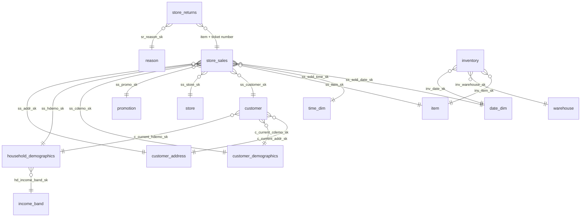

# Data dictionary: TPC-DS retail warehouse

This is the database the agents query. It is the schema of **[TPC-DS](https://www.tpc.org/tpcds/)**, the industry's
standard benchmark for decision-support (analytics) systems, generated by DuckDB's `tpcds` extension. The
sections before the column reference are written by hand. The column reference is generated from the same
semantic catalog the agents read (`backend/semantic/`), so the two can't drift apart.

## What the data represents

A fictional US retailer sells through **three channels**:

| Channel | Sales table | Returns table | Where the sale happens |
|---|---|---|---|
| Physical stores | `store_sales` | `store_returns` | A store (`store`) |
| Mail/phone catalog | `catalog_sales` | `catalog_returns` | A catalog page (`catalog_page`), taken by a call center (`call_center`), shipped from a warehouse |
| Website | `web_sales` | `web_returns` | A web page/site (`web_page`, `web_site`), shipped from a warehouse |

Around these sit shared descriptions of **products** (`item`), **customers** (`customer` plus address and
demographics), **time** (`date_dim`, `time_dim`), **promotions** and **return reasons**, plus a weekly
**inventory** snapshot per item and warehouse.

**Size at scale factor 1 (SF1):** 24 tables, 425 columns, about 19.6 million rows, 315 MB in DuckDB. Higher scale
factors grow the fact tables roughly linearly (SF10 has about 29M store sales rows).

**Time span:** sales run from **1998-01-02 to 2003-01-02**, so 1998–2002 are full years. Returns extend into
late 2003. `date_dim` covers 1900–2100, but only that window has activity. "Last year" therefore means **2002**,
not the current calendar year. The agents are told this explicitly.

**The data is synthetic.** Names, numbers and distributions are generated to be realistic for benchmarking, but
some text columns contain generated filler (pseudo-words like `ought`, `eing`, or random sentences). Those
columns are marked "generated filler text" in the reference below.

## How the warehouse is organised

It is a **snowflake schema**:
- **Fact tables** record events (a line item sold, returned or stocked) and hold the numbers you add up.
- **Dimension tables** describe the who, what, where and when of each event.

Facts point to dimensions through keys ending in `_sk`.

The diagram shows the store channel. Catalog and web follow the same pattern, with extra links to `warehouse`,
`ship_mode`, `call_center` / `catalog_page` (catalog) and `web_page` / `web_site` (web). The column reference
lists every link under "Links to".

## Naming conventions

**Prefixes.** Every column starts with a short prefix naming its table:

| Prefix | Table | Prefix | Table | Prefix | Table |
|---|---|---|---|---|---|
| `ss_` | store_sales | `sr_` | store_returns | `inv_` | inventory |
| `cs_` | catalog_sales | `cr_` | catalog_returns | `d_` | date_dim |
| `ws_` | web_sales | `wr_` | web_returns | `t_` | time_dim |
| `i_` | item | `c_` | customer | `ca_` | customer_address |
| `cd_` | customer_demographics | `hd_` | household_demographics | `ib_` | income_band |
| `s_` | store | `w_` | warehouse | `cc_` | call_center |
| `cp_` | catalog_page | `wp_` | web_page | `web_` | web_site |
| `sm_` | ship_mode | `p_` | promotion | `r_` | reason |

**Abbreviations:** `ext` = extended (unit value × quantity), `amt` = amount, `inc` = including, `cdemo` /
`hdemo` = customer / household demographics, `addr` = address, `moy` / `dom` / `qoy` / `dow` = month of year /
day of month / quarter of year / day of week, `seq` = running sequence number, `ly` / `lq` = last year / last
quarter.

**Key types:**
- **`_sk` (surrogate key):** an integer used only for joining. `ss_item_sk = i_item_sk` is how a sale finds its
  product. Date keys are Julian day numbers (e.g. `2452349` = 2002-03-15), which is why some `date_dim` columns
  such as `d_same_day_ly` hold keys rather than dates.
- **`_id` (business key):** a 16-character code like `AAAAAAAABAAAAAAA` that identifies the real-world thing.
- **Versioned dimensions:** `item`, `store`, `call_center`, `web_page` and `web_site` keep history. A product
  whose price changed has several rows with the same `i_item_id`, different `i_item_sk`, and validity dates
  (`i_rec_start_date`, `i_rec_end_date`; end date NULL = current version). **Count products with
  `COUNT(DISTINCT i_item_id)`, not `i_item_sk`.**
  To rank products, group by `i_item_id` only and show a name with `ANY_VALUE(i_product_name)`: 5,986 products
  have different names across versions, so grouping by name as well splits them into several rows.

## The money columns, explained

Every sales line follows the same arithmetic (shown here for store sales; catalog and web use `cs_` / `ws_`):

| Step | Column | Meaning |
|---|---|---|
| Sticker price | `ss_list_price` | Unit list price |
| Actual unit price | `ss_sales_price` | After discount |
| × quantity | `ss_ext_list_price`, `ss_ext_sales_price`, `ss_ext_discount_amt` | Line totals; `ext_sales_price` is **gross sales** |
| − coupon | `ss_coupon_amt` | Coupon discount on the line |
| = **revenue** | `ss_net_paid` | `ext_sales_price − coupon_amt` (verified exact in the data) |
| − cost of goods | `ss_ext_wholesale_cost` | `wholesale_cost × quantity` |
| = **profit** | `ss_net_profit` | `net_paid − ext_wholesale_cost` (verified exact) |
| + tax / shipping | `*_net_paid_inc_tax`, `*_inc_ship`, `*_inc_ship_tax` | Revenue including tax and/or shipping |

Standard business metrics, as defined for the agents in `backend/semantic/tpcds.yaml`:

| Metric | Definition |
|---|---|
| Revenue | `SUM(*_net_paid)` |
| Gross sales | `SUM(*_ext_sales_price)` |
| Profit | `SUM(*_net_profit)` |
| Units sold | `SUM(*_quantity)` |
| Orders | `COUNT(DISTINCT ss_ticket_number)` for stores; `COUNT(DISTINCT *_order_number)` for catalog/web |
| Average order value | Revenue ÷ orders |
| Return rate | Returned units ÷ sold units, same channel and period |

## Rules of thumb for querying

1. **All-channel totals:** aggregate each sales table separately, then `UNION ALL`. Never join the three sales
   tables to each other.
2. **Linking a return to its sale** uses two columns: `store_returns ↔ store_sales` on item + ticket number,
   and `catalog_returns ↔ catalog_sales` / `web_returns ↔ web_sales` on item + order number.
3. **Filtering by time:** join the fact's `*_date_sk` to `date_dim.d_date_sk`, then filter on `d_year`,
   `d_moy`, `d_qoy` and so on.
4. **"At the time of purchase" vs "now":** a sale's `ss_cdemo_sk` / `ss_addr_sk` describe the customer when they
   bought. `customer.c_current_*_sk` describe them today.
5. **Catalog and web have two customers per order:** `bill_*` (who paid) and `ship_*` (who received). Use
   `bill_*` for "who bought".

## Data quirks worth knowing

- **NULL foreign keys:** about 4.5% of `store_sales` rows have no sale date (`ss_sold_date_sk` is NULL), and
  other keys have similar gaps. Inner joins silently drop these rows, which is usually what's wanted.
- **Placeholder and constant columns:** `p_cost` is always 1000.00 and `p_response_target` always 1.
  `i_container`, `p_purpose`, `s_geography_class` and several division/company names are `'Unknown'` or
  placeholders. Don't analyse them.
- **Few stores at SF1:** only 12 stores, all in Tennessee. Customers, by contrast, span 51 states and
  territories.
- **`d_current_*` flags** mark a fixed benchmark "today" and should be ignored.
- **Spelling preserved from the source:** one return reason reads `'Not the product that was ordred'`. Filters
  must match it exactly.
- **Unknown values:** `hd_vehicle_count = -1` means unknown; demographic text fields use `'Unknown'`.

## Column reference

Generated from `backend/semantic/tpcds.catalog.json`. "Values" lists the complete set of values for
low-cardinality columns, otherwise the most common examples.

<!-- BEGIN GENERATED: run `uv run sqlagent docs` in backend/ to refresh -->

## Sales facts

### `store_sales`: Store sales

One row per item on an in-store purchase receipt. The largest fact table.  
**Type:** fact · **Rows (SF1):** 2,880,404 · **Columns:** 23
  
**Business terms:** in-store sales, retail sales, POS transactions, receipts, physical store revenue
  
**Data covers:** 1998-01-02 to 2003-01-02 (by `ss_sold_date_sk`)

| Column | Type | Meaning | Links to | Values |
|---|---|---|---|---|
| `ss_sold_date_sk` | BIGINT | Sold date: links to date_dim. | `date_dim.d_date_sk` |  |
| `ss_sold_time_sk` | BIGINT | Sold time: links to time_dim. | `time_dim.t_time_sk` |  |
| `ss_item_sk` | BIGINT | Item: links to item. | `item.i_item_sk` |  |
| `ss_customer_sk` | BIGINT | Customer: links to customer. | `customer.c_customer_sk` |  |
| `ss_cdemo_sk` | BIGINT | Customer demographics: links to customer_demographics. | `customer_demographics.cd_demo_sk` |  |
| `ss_hdemo_sk` | BIGINT | Household demographics: links to household_demographics. | `household_demographics.hd_demo_sk` |  |
| `ss_addr_sk` | BIGINT | Address: links to customer_address. | `customer_address.ca_address_sk` |  |
| `ss_store_sk` | BIGINT | Store: links to store. | `store.s_store_sk` |  |
| `ss_promo_sk` | BIGINT | Promotion: links to promotion. | `promotion.p_promo_sk` |  |
| `ss_ticket_number` | BIGINT | Store receipt number; groups line items bought in one store visit. |  |  |
| `ss_quantity` | BIGINT | Number of units sold on this line item. |  |  |
| `ss_wholesale_cost` | DECIMAL(7,2) | Unit cost the retailer paid for the item. |  |  |
| `ss_list_price` | DECIMAL(7,2) | Unit list (sticker) price before any discount. |  |  |
| `ss_sales_price` | DECIMAL(7,2) | Unit price actually charged after discount. |  |  |
| `ss_ext_discount_amt` | DECIMAL(7,2) | Total discount on the line = (list_price - sales_price) x quantity. |  |  |
| `ss_ext_sales_price` | DECIMAL(7,2) | Gross sales amount for the line = sales_price x quantity. "Gross sales". |  |  |
| `ss_ext_wholesale_cost` | DECIMAL(7,2) | Total cost of goods for the line = wholesale_cost x quantity. |  |  |
| `ss_ext_list_price` | DECIMAL(7,2) | List price x quantity. |  |  |
| `ss_ext_tax` | DECIMAL(7,2) | Sales tax charged on the line. |  |  |
| `ss_coupon_amt` | DECIMAL(7,2) | Coupon discount applied to the line. |  |  |
| `ss_net_paid` | DECIMAL(7,2) | Net revenue = ext_sales_price - coupon_amt. Use for "revenue" / "net sales". |  |  |
| `ss_net_paid_inc_tax` | DECIMAL(7,2) | Net revenue including tax. |  |  |
| `ss_net_profit` | DECIMAL(7,2) | Profit = net_paid - ext_wholesale_cost. Use for "profit" / "margin". |  |  |

### `catalog_sales`: Catalog sales

One row per item on a mail/phone catalog order.  
**Type:** fact · **Rows (SF1):** 1,441,548 · **Columns:** 34
  
**Business terms:** catalog orders, mail order sales, phone orders
  
**Data covers:** 1998-01-01 to 2003-01-08 (by `cs_sold_date_sk`)

| Column | Type | Meaning | Links to | Values |
|---|---|---|---|---|
| `cs_sold_date_sk` | BIGINT | Sold date: links to date_dim. | `date_dim.d_date_sk` |  |
| `cs_sold_time_sk` | BIGINT | Sold time: links to time_dim. | `time_dim.t_time_sk` |  |
| `cs_ship_date_sk` | BIGINT | Ship date: links to date_dim. | `date_dim.d_date_sk` |  |
| `cs_bill_customer_sk` | BIGINT | Bill customer: links to customer. | `customer.c_customer_sk` |  |
| `cs_bill_cdemo_sk` | BIGINT | Bill customer demographics: links to customer_demographics. | `customer_demographics.cd_demo_sk` |  |
| `cs_bill_hdemo_sk` | BIGINT | Bill household demographics: links to household_demographics. | `household_demographics.hd_demo_sk` |  |
| `cs_bill_addr_sk` | BIGINT | Bill address: links to customer_address. | `customer_address.ca_address_sk` |  |
| `cs_ship_customer_sk` | BIGINT | Ship customer: links to customer. | `customer.c_customer_sk` |  |
| `cs_ship_cdemo_sk` | BIGINT | Ship customer demographics: links to customer_demographics. | `customer_demographics.cd_demo_sk` |  |
| `cs_ship_hdemo_sk` | BIGINT | Ship household demographics: links to household_demographics. | `household_demographics.hd_demo_sk` |  |
| `cs_ship_addr_sk` | BIGINT | Ship address: links to customer_address. | `customer_address.ca_address_sk` |  |
| `cs_call_center_sk` | BIGINT | Call center: links to call_center. | `call_center.cc_call_center_sk` |  |
| `cs_catalog_page_sk` | BIGINT | Catalog page: links to catalog_page. | `catalog_page.cp_catalog_page_sk` |  |
| `cs_ship_mode_sk` | BIGINT | Ship mode: links to ship_mode. | `ship_mode.sm_ship_mode_sk` |  |
| `cs_warehouse_sk` | BIGINT | Warehouse: links to warehouse. | `warehouse.w_warehouse_sk` |  |
| `cs_item_sk` | BIGINT | Item: links to item. | `item.i_item_sk` |  |
| `cs_promo_sk` | BIGINT | Promotion: links to promotion. | `promotion.p_promo_sk` |  |
| `cs_order_number` | BIGINT | Order number; groups line items in one catalog or web order. |  |  |
| `cs_quantity` | BIGINT | Number of units sold on this line item. |  |  |
| `cs_wholesale_cost` | DECIMAL(7,2) | Unit cost the retailer paid for the item. |  |  |
| `cs_list_price` | DECIMAL(7,2) | Unit list (sticker) price before any discount. |  |  |
| `cs_sales_price` | DECIMAL(7,2) | Unit price actually charged after discount. |  |  |
| `cs_ext_discount_amt` | DECIMAL(7,2) | Total discount on the line = (list_price - sales_price) x quantity. |  |  |
| `cs_ext_sales_price` | DECIMAL(7,2) | Gross sales amount for the line = sales_price x quantity. "Gross sales". |  |  |
| `cs_ext_wholesale_cost` | DECIMAL(7,2) | Total cost of goods for the line = wholesale_cost x quantity. |  |  |
| `cs_ext_list_price` | DECIMAL(7,2) | List price x quantity. |  |  |
| `cs_ext_tax` | DECIMAL(7,2) | Sales tax charged on the line. |  |  |
| `cs_coupon_amt` | DECIMAL(7,2) | Coupon discount applied to the line. |  |  |
| `cs_ext_ship_cost` | DECIMAL(7,2) | Shipping cost charged for the line. |  |  |
| `cs_net_paid` | DECIMAL(7,2) | Net revenue = ext_sales_price - coupon_amt. Use for "revenue" / "net sales". |  |  |
| `cs_net_paid_inc_tax` | DECIMAL(7,2) | Net revenue including tax. |  |  |
| `cs_net_paid_inc_ship` | DECIMAL(7,2) | Net revenue including shipping. |  |  |
| `cs_net_paid_inc_ship_tax` | DECIMAL(7,2) | Net revenue including shipping and tax. |  |  |
| `cs_net_profit` | DECIMAL(7,2) | Profit = net_paid - ext_wholesale_cost. Use for "profit" / "margin". |  |  |

### `web_sales`: Web sales

One row per item on an online order.  
**Type:** fact · **Rows (SF1):** 719,384 · **Columns:** 34
  
**Business terms:** online sales, e-commerce orders, website sales, internet sales
  
**Data covers:** 1998-01-02 to 2003-01-02 (by `ws_sold_date_sk`)

| Column | Type | Meaning | Links to | Values |
|---|---|---|---|---|
| `ws_sold_date_sk` | BIGINT | Sold date: links to date_dim. | `date_dim.d_date_sk` |  |
| `ws_sold_time_sk` | BIGINT | Sold time: links to time_dim. | `time_dim.t_time_sk` |  |
| `ws_ship_date_sk` | BIGINT | Ship date: links to date_dim. | `date_dim.d_date_sk` |  |
| `ws_item_sk` | BIGINT | Item: links to item. | `item.i_item_sk` |  |
| `ws_bill_customer_sk` | BIGINT | Bill customer: links to customer. | `customer.c_customer_sk` |  |
| `ws_bill_cdemo_sk` | BIGINT | Bill customer demographics: links to customer_demographics. | `customer_demographics.cd_demo_sk` |  |
| `ws_bill_hdemo_sk` | BIGINT | Bill household demographics: links to household_demographics. | `household_demographics.hd_demo_sk` |  |
| `ws_bill_addr_sk` | BIGINT | Bill address: links to customer_address. | `customer_address.ca_address_sk` |  |
| `ws_ship_customer_sk` | BIGINT | Ship customer: links to customer. | `customer.c_customer_sk` |  |
| `ws_ship_cdemo_sk` | BIGINT | Ship customer demographics: links to customer_demographics. | `customer_demographics.cd_demo_sk` |  |
| `ws_ship_hdemo_sk` | BIGINT | Ship household demographics: links to household_demographics. | `household_demographics.hd_demo_sk` |  |
| `ws_ship_addr_sk` | BIGINT | Ship address: links to customer_address. | `customer_address.ca_address_sk` |  |
| `ws_web_page_sk` | BIGINT | Web page: links to web_page. | `web_page.wp_web_page_sk` |  |
| `ws_web_site_sk` | BIGINT | Web site: links to web_site. | `web_site.web_site_sk` |  |
| `ws_ship_mode_sk` | BIGINT | Ship mode: links to ship_mode. | `ship_mode.sm_ship_mode_sk` |  |
| `ws_warehouse_sk` | BIGINT | Warehouse: links to warehouse. | `warehouse.w_warehouse_sk` |  |
| `ws_promo_sk` | BIGINT | Promotion: links to promotion. | `promotion.p_promo_sk` |  |
| `ws_order_number` | BIGINT | Order number; groups line items in one catalog or web order. |  |  |
| `ws_quantity` | BIGINT | Number of units sold on this line item. |  |  |
| `ws_wholesale_cost` | DECIMAL(7,2) | Unit cost the retailer paid for the item. |  |  |
| `ws_list_price` | DECIMAL(7,2) | Unit list (sticker) price before any discount. |  |  |
| `ws_sales_price` | DECIMAL(7,2) | Unit price actually charged after discount. |  |  |
| `ws_ext_discount_amt` | DECIMAL(7,2) | Total discount on the line = (list_price - sales_price) x quantity. |  |  |
| `ws_ext_sales_price` | DECIMAL(7,2) | Gross sales amount for the line = sales_price x quantity. "Gross sales". |  |  |
| `ws_ext_wholesale_cost` | DECIMAL(7,2) | Total cost of goods for the line = wholesale_cost x quantity. |  |  |
| `ws_ext_list_price` | DECIMAL(7,2) | List price x quantity. |  |  |
| `ws_ext_tax` | DECIMAL(7,2) | Sales tax charged on the line. |  |  |
| `ws_coupon_amt` | DECIMAL(7,2) | Coupon discount applied to the line. |  |  |
| `ws_ext_ship_cost` | DECIMAL(7,2) | Shipping cost charged for the line. |  |  |
| `ws_net_paid` | DECIMAL(7,2) | Net revenue = ext_sales_price - coupon_amt. Use for "revenue" / "net sales". |  |  |
| `ws_net_paid_inc_tax` | DECIMAL(7,2) | Net revenue including tax. |  |  |
| `ws_net_paid_inc_ship` | DECIMAL(7,2) | Net revenue including shipping. |  |  |
| `ws_net_paid_inc_ship_tax` | DECIMAL(7,2) | Net revenue including shipping and tax. |  |  |
| `ws_net_profit` | DECIMAL(7,2) | Profit = net_paid - ext_wholesale_cost. Use for "profit" / "margin". |  |  |

## Returns facts

### `store_returns`: Store returns

One row per item returned to a physical store.  
**Type:** fact · **Rows (SF1):** 287,514 · **Columns:** 20
  
**Business terms:** in-store returns, refunds
  
**Data covers:** 1998-01-06 to 2003-07-01 (by `sr_returned_date_sk`)

| Column | Type | Meaning | Links to | Values |
|---|---|---|---|---|
| `sr_returned_date_sk` | BIGINT | Returned date: links to date_dim. | `date_dim.d_date_sk` |  |
| `sr_return_time_sk` | BIGINT | Return time: links to time_dim. | `time_dim.t_time_sk` |  |
| `sr_item_sk` | BIGINT | Item: links to item. | `item.i_item_sk` |  |
| `sr_customer_sk` | BIGINT | Customer: links to customer. | `customer.c_customer_sk` |  |
| `sr_cdemo_sk` | BIGINT | Customer demographics: links to customer_demographics. | `customer_demographics.cd_demo_sk` |  |
| `sr_hdemo_sk` | BIGINT | Household demographics: links to household_demographics. | `household_demographics.hd_demo_sk` |  |
| `sr_addr_sk` | BIGINT | Address: links to customer_address. | `customer_address.ca_address_sk` |  |
| `sr_store_sk` | BIGINT | Store: links to store. | `store.s_store_sk` |  |
| `sr_reason_sk` | BIGINT | Reason: links to reason. | `reason.r_reason_sk` |  |
| `sr_ticket_number` | BIGINT | Store receipt number; groups line items bought in one store visit. |  |  |
| `sr_return_quantity` | BIGINT | Number of units returned. |  |  |
| `sr_return_amt` | DECIMAL(7,2) | Refund amount before tax. |  |  |
| `sr_return_tax` | DECIMAL(7,2) | Tax refunded. |  |  |
| `sr_return_amt_inc_tax` | DECIMAL(7,2) | Refund amount including tax. |  |  |
| `sr_fee` | DECIMAL(7,2) | Restocking/return fee charged to the customer. |  |  |
| `sr_return_ship_cost` | DECIMAL(7,2) | Shipping cost of the return. |  |  |
| `sr_refunded_cash` | DECIMAL(7,2) | Portion refunded as cash. |  |  |
| `sr_reversed_charge` | DECIMAL(7,2) | Portion refunded by reversing a card charge. |  |  |
| `sr_store_credit` | DECIMAL(7,2) | Portion refunded as store credit. |  |  |
| `sr_net_loss` | DECIMAL(7,2) | Net loss to the retailer from the return. |  |  |

### `catalog_returns`: Catalog returns

One row per item returned from a catalog order.  
**Type:** fact · **Rows (SF1):** 144,067 · **Columns:** 27
  
**Business terms:** catalog refunds
  
**Data covers:** 1998-01-08 to 2003-09-24 (by `cr_returned_date_sk`)

| Column | Type | Meaning | Links to | Values |
|---|---|---|---|---|
| `cr_returned_date_sk` | BIGINT | Returned date: links to date_dim. | `date_dim.d_date_sk` |  |
| `cr_returned_time_sk` | BIGINT | Returned time: links to time_dim. | `time_dim.t_time_sk` |  |
| `cr_item_sk` | BIGINT | Item: links to item. | `item.i_item_sk` |  |
| `cr_refunded_customer_sk` | BIGINT | Refunded customer: links to customer. | `customer.c_customer_sk` |  |
| `cr_refunded_cdemo_sk` | BIGINT | Refunded customer demographics: links to customer_demographics. | `customer_demographics.cd_demo_sk` |  |
| `cr_refunded_hdemo_sk` | BIGINT | Refunded household demographics: links to household_demographics. | `household_demographics.hd_demo_sk` |  |
| `cr_refunded_addr_sk` | BIGINT | Refunded address: links to customer_address. | `customer_address.ca_address_sk` |  |
| `cr_returning_customer_sk` | BIGINT | Returning customer: links to customer. | `customer.c_customer_sk` |  |
| `cr_returning_cdemo_sk` | BIGINT | Returning customer demographics: links to customer_demographics. | `customer_demographics.cd_demo_sk` |  |
| `cr_returning_hdemo_sk` | BIGINT | Returning household demographics: links to household_demographics. | `household_demographics.hd_demo_sk` |  |
| `cr_returning_addr_sk` | BIGINT | Returning address: links to customer_address. | `customer_address.ca_address_sk` |  |
| `cr_call_center_sk` | BIGINT | Call center: links to call_center. | `call_center.cc_call_center_sk` |  |
| `cr_catalog_page_sk` | BIGINT | Catalog page: links to catalog_page. | `catalog_page.cp_catalog_page_sk` |  |
| `cr_ship_mode_sk` | BIGINT | Ship mode: links to ship_mode. | `ship_mode.sm_ship_mode_sk` |  |
| `cr_warehouse_sk` | BIGINT | Warehouse: links to warehouse. | `warehouse.w_warehouse_sk` |  |
| `cr_reason_sk` | BIGINT | Reason: links to reason. | `reason.r_reason_sk` |  |
| `cr_order_number` | BIGINT | Order number; groups line items in one catalog or web order. |  |  |
| `cr_return_quantity` | BIGINT | Number of units returned. |  |  |
| `cr_return_amount` | DECIMAL(7,2) | Refund amount before tax. |  |  |
| `cr_return_tax` | DECIMAL(7,2) | Tax refunded. |  |  |
| `cr_return_amt_inc_tax` | DECIMAL(7,2) | Refund amount including tax. |  |  |
| `cr_fee` | DECIMAL(7,2) | Restocking/return fee charged to the customer. |  |  |
| `cr_return_ship_cost` | DECIMAL(7,2) | Shipping cost of the return. |  |  |
| `cr_refunded_cash` | DECIMAL(7,2) | Portion refunded as cash. |  |  |
| `cr_reversed_charge` | DECIMAL(7,2) | Portion refunded by reversing a card charge. |  |  |
| `cr_store_credit` | DECIMAL(7,2) | Portion refunded as store credit. |  |  |
| `cr_net_loss` | DECIMAL(7,2) | Net loss to the retailer from the return. |  |  |

### `web_returns`: Web returns

One row per item returned from a web order.  
**Type:** fact · **Rows (SF1):** 71,763 · **Columns:** 24
  
**Business terms:** online returns, web refunds
  
**Data covers:** 1998-01-28 to 2003-12-21 (by `wr_returned_date_sk`)

| Column | Type | Meaning | Links to | Values |
|---|---|---|---|---|
| `wr_returned_date_sk` | BIGINT | Returned date: links to date_dim. | `date_dim.d_date_sk` |  |
| `wr_returned_time_sk` | BIGINT | Returned time: links to time_dim. | `time_dim.t_time_sk` |  |
| `wr_item_sk` | BIGINT | Item: links to item. | `item.i_item_sk` |  |
| `wr_refunded_customer_sk` | BIGINT | Refunded customer: links to customer. | `customer.c_customer_sk` |  |
| `wr_refunded_cdemo_sk` | BIGINT | Refunded customer demographics: links to customer_demographics. | `customer_demographics.cd_demo_sk` |  |
| `wr_refunded_hdemo_sk` | BIGINT | Refunded household demographics: links to household_demographics. | `household_demographics.hd_demo_sk` |  |
| `wr_refunded_addr_sk` | BIGINT | Refunded address: links to customer_address. | `customer_address.ca_address_sk` |  |
| `wr_returning_customer_sk` | BIGINT | Returning customer: links to customer. | `customer.c_customer_sk` |  |
| `wr_returning_cdemo_sk` | BIGINT | Returning customer demographics: links to customer_demographics. | `customer_demographics.cd_demo_sk` |  |
| `wr_returning_hdemo_sk` | BIGINT | Returning household demographics: links to household_demographics. | `household_demographics.hd_demo_sk` |  |
| `wr_returning_addr_sk` | BIGINT | Returning address: links to customer_address. | `customer_address.ca_address_sk` |  |
| `wr_web_page_sk` | BIGINT | Web page: links to web_page. | `web_page.wp_web_page_sk` |  |
| `wr_reason_sk` | BIGINT | Reason: links to reason. | `reason.r_reason_sk` |  |
| `wr_order_number` | BIGINT | Order number; groups line items in one catalog or web order. |  |  |
| `wr_return_quantity` | BIGINT | Number of units returned. |  |  |
| `wr_return_amt` | DECIMAL(7,2) | Refund amount before tax. |  |  |
| `wr_return_tax` | DECIMAL(7,2) | Tax refunded. |  |  |
| `wr_return_amt_inc_tax` | DECIMAL(7,2) | Refund amount including tax. |  |  |
| `wr_fee` | DECIMAL(7,2) | Restocking/return fee charged to the customer. |  |  |
| `wr_return_ship_cost` | DECIMAL(7,2) | Shipping cost of the return. |  |  |
| `wr_refunded_cash` | DECIMAL(7,2) | Portion refunded as cash. |  |  |
| `wr_reversed_charge` | DECIMAL(7,2) | Portion refunded by reversing a card charge. |  |  |
| `wr_account_credit` | DECIMAL(7,2) | Portion refunded as web account credit. |  |  |
| `wr_net_loss` | DECIMAL(7,2) | Net loss to the retailer from the return. |  |  |

## Inventory fact

### `inventory`: Inventory snapshots

Weekly quantity on hand for each item in each warehouse.  
**Type:** fact · **Rows (SF1):** 11,745,000 · **Columns:** 4
  
**Business terms:** stock, stock levels, on-hand inventory
  
**Data covers:** 1998-01-01 to 2002-12-26 (by `inv_date_sk`)

| Column | Type | Meaning | Links to | Values |
|---|---|---|---|---|
| `inv_date_sk` | BIGINT | Date: links to date_dim. | `date_dim.d_date_sk` |  |
| `inv_item_sk` | BIGINT | Item: links to item. | `item.i_item_sk` |  |
| `inv_warehouse_sk` | BIGINT | Warehouse: links to warehouse. | `warehouse.w_warehouse_sk` |  |
| `inv_quantity_on_hand` | INTEGER | Units in stock at the warehouse on that snapshot date. |  |  |

## Time dimensions

### `date_dim`: Calendar

One row per calendar day. Join any *_date_sk column here to filter or group by year, quarter, month, weekday or holiday.  
**Type:** dimension · **Rows (SF1):** 73,049 · **Columns:** 28
  
**Business terms:** date, day, month, year, quarter, week, calendar, when, holiday, weekend

| Column | Type | Meaning | Links to | Values |
|---|---|---|---|---|
| `d_date_sk` | BIGINT | Primary key: unique row ID that other tables join on. |  |  |
| `d_date_id` | VARCHAR | Business key, 16-char code (e.g. 'AAAAAAAANHLGFCAA'). |  |  |
| `d_date` | DATE | The calendar date. |  |  |
| `d_month_seq` | BIGINT | Running month counter; use for month ranges spanning years. |  |  |
| `d_week_seq` | BIGINT | Running week counter. |  |  |
| `d_quarter_seq` | BIGINT | Running quarter counter; use for quarter ranges spanning years. |  |  |
| `d_year` | BIGINT | Calendar year, e.g. 2001. |  |  |
| `d_dow` | BIGINT | Day of week number, 0=Sunday ... 6=Saturday. |  |  |
| `d_moy` | BIGINT | Month number 1-12. |  |  |
| `d_dom` | BIGINT | Day of month 1-31. |  |  |
| `d_qoy` | BIGINT | Quarter number 1-4. |  |  |
| `d_fy_year` | BIGINT | Fiscal year; same as the calendar year in this data. |  |  |
| `d_fy_quarter_seq` | BIGINT | Running fiscal-quarter counter. |  |  |
| `d_fy_week_seq` | BIGINT | Running fiscal-week counter. |  |  |
| `d_day_name` | VARCHAR | Weekday name, e.g. 'Monday'. |  | `Thursday`, `Monday`, `Tuesday`, `Friday`, `Saturday`, `Sunday`, `Wednesday` |
| `d_quarter_name` | VARCHAR | Quarter label, e.g. '2002Q1'. |  | e.g. `1900Q3`, `1900Q4`, `1901Q3` |
| `d_holiday` | VARCHAR | 'Y' if the day is a holiday. |  | `N`, `Y` |
| `d_weekend` | VARCHAR | 'Y' if Saturday or Sunday. |  | `N`, `Y` |
| `d_following_holiday` | VARCHAR | 'Y' if the day after a holiday. |  | `N`, `Y` |
| `d_first_dom` | BIGINT | d_date_sk of the first day of this month (a date key, not a date). |  |  |
| `d_last_dom` | BIGINT | d_date_sk of the last day of this month (a date key, not a date). |  |  |
| `d_same_day_ly` | BIGINT | d_date_sk of the same day last year; use for year-over-year comparisons. |  |  |
| `d_same_day_lq` | BIGINT | d_date_sk of the same day last quarter. |  |  |
| `d_current_day` | VARCHAR | Benchmark 'today' flags (Y/N). Ignore: relative dates are anchored to the data coverage. |  | `N` |
| `d_current_week` | VARCHAR | Benchmark flag; ignore (see d_current_day). |  | `N` |
| `d_current_month` | VARCHAR | Benchmark flag; ignore (see d_current_day). |  | `N`, `Y` |
| `d_current_quarter` | VARCHAR | Benchmark flag; ignore (see d_current_day). |  | `N`, `Y` |
| `d_current_year` | VARCHAR | Benchmark flag; ignore (see d_current_day). |  | `N`, `Y` |

### `time_dim`: Time of day

One row per second of the day. Join *_time_sk here for hour or shift analysis.  
**Type:** dimension · **Rows (SF1):** 86,400 · **Columns:** 10
  
**Business terms:** hour, time of day, shift, morning, evening, meal time, breakfast, lunch, dinner

| Column | Type | Meaning | Links to | Values |
|---|---|---|---|---|
| `t_time_sk` | BIGINT | Primary key: unique row ID that other tables join on. |  |  |
| `t_time_id` | VARCHAR | Business key, 16-char code. |  |  |
| `t_time` | BIGINT | Seconds since midnight (0-86399); equal to t_time_sk. |  |  |
| `t_hour` | BIGINT | Hour of day 0-23. |  |  |
| `t_minute` | BIGINT | Minute 0-59. |  |  |
| `t_second` | BIGINT | Second 0-59. |  |  |
| `t_am_pm` | VARCHAR | 'AM' or 'PM'. |  | `AM`, `PM` |
| `t_shift` | VARCHAR | Work shift name, e.g. 'first', 'second', 'third'. |  | `first`, `second`, `third` |
| `t_sub_shift` | VARCHAR | Part of day: 'morning', 'afternoon', 'evening' or 'night'. |  | `evening`, `morning`, `night`, `afternoon` |
| `t_meal_time` | VARCHAR | Meal period ('breakfast', 'lunch', 'dinner') or NULL. |  | `breakfast`, `dinner`, `lunch` |

## Product dimension

### `item`: Products

Product catalog with category, class, brand and price. Several versions per product may exist (rec_start_date/rec_end_date).  
**Type:** dimension · **Rows (SF1):** 18,000 · **Columns:** 22
  
**Business terms:** product, products, SKU, merchandise, goods, brand, category, department

| Column | Type | Meaning | Links to | Values |
|---|---|---|---|---|
| `i_item_sk` | BIGINT | Primary key: unique row ID that other tables join on. |  |  |
| `i_item_id` | VARCHAR | Product business code; stable across record versions. Use it to count distinct products. |  |  |
| `i_rec_start_date` | DATE | Start of validity for this version of the record (slowly changing dimension). |  |  |
| `i_rec_end_date` | DATE | End of validity for this version of the record; NULL means current. |  |  |
| `i_item_desc` | VARCHAR | Free-text product description (generated filler text). |  |  |
| `i_current_price` | DECIMAL(7,2) | Current unit price. |  |  |
| `i_wholesale_cost` | DECIMAL(7,2) | Unit cost to the retailer (0.02-87.36). |  |  |
| `i_brand_id` | BIGINT | Numeric brand code; pairs with i_brand. |  |  |
| `i_brand` | VARCHAR | Brand name. |  | e.g. `edu packscholar #1`, `importoscholar #2`, `importoimporto #2` |
| `i_class_id` | BIGINT | Numeric sub-category code; pairs with i_class. |  |  |
| `i_class` | VARCHAR | Sub-category within a category. |  | e.g. `kids`, `classical`, `shirts` |
| `i_category_id` | BIGINT | Numeric category code; pairs with i_category. |  |  |
| `i_category` | VARCHAR | Top-level product category, e.g. 'Books', 'Electronics', 'Women'. |  | `Music`, `Shoes`, `Electronics`, `Men`, `Home`, `Women`, `Children`, `Sports`, `Jewelry`, `Books` |
| `i_manufact_id` | BIGINT | Manufacturer number. |  |  |
| `i_manufact` | VARCHAR | Manufacturer name (generated pseudo-word). |  | e.g. `callyoughtought`, `ationeseought`, `eingantiought` |
| `i_size` | VARCHAR | Size, e.g. 'small', 'medium', 'large', 'petite', 'N/A'. |  | `N/A`, `medium`, `large`, `small`, `petite`, `extra large`, `economy` |
| `i_formulation` | VARCHAR | Product formulation code (generated). |  | e.g. `00588802055807peach8`, `0064sky6890999816999`, `007smoke758094520928` |
| `i_color` | VARCHAR | Color, e.g. 'slate', 'turquoise'. |  | e.g. `turquoise`, `slate`, `smoke` |
| `i_units` | VARCHAR | Unit of measure, e.g. 'Each', 'Pound', 'Carton'. |  | `Cup`, `Carton`, `Oz`, `Dram`, `N/A`, `Ounce`, `Case`, `Dozen`, `Ton`, `Tsp`, `Pallet`, `Unknown`, … |
| `i_container` | VARCHAR | Container type (always 'Unknown' in this data). |  | `Unknown` |
| `i_manager_id` | BIGINT | Numeric ID of the merchandise manager responsible for the item. |  |  |
| `i_product_name` | VARCHAR | Product name. |  | e.g. `able`, `ableable`, `ableableable` |

## Customer dimensions

### `customer`: Customers

One row per customer, with name, email, birth date and links to their current address and demographics.  
**Type:** dimension · **Rows (SF1):** 100,000 · **Columns:** 18
  
**Business terms:** customers, shoppers, buyers, clients, people, users

| Column | Type | Meaning | Links to | Values |
|---|---|---|---|---|
| `c_customer_sk` | BIGINT | Primary key: unique row ID that other tables join on. |  |  |
| `c_customer_id` | VARCHAR | Customer business code. |  |  |
| `c_current_cdemo_sk` | BIGINT | Customer's current demographic profile (join customer_demographics). | `customer_demographics.cd_demo_sk` |  |
| `c_current_hdemo_sk` | BIGINT | Customer's current household profile (join household_demographics). | `household_demographics.hd_demo_sk` |  |
| `c_current_addr_sk` | BIGINT | Customer's current address (join customer_address). | `customer_address.ca_address_sk` |  |
| `c_first_shipto_date_sk` | BIGINT | Date of the customer's first shipment (join date_dim). | `date_dim.d_date_sk` |  |
| `c_first_sales_date_sk` | BIGINT | Date of the customer's first purchase (join date_dim). | `date_dim.d_date_sk` |  |
| `c_salutation` | VARCHAR | Title, e.g. 'Mr.', 'Ms.', 'Dr.'. |  | `Dr.`, `Mr.`, `Sir`, `Mrs.`, `Ms.`, `Miss` |
| `c_first_name` | VARCHAR | First name. |  | e.g. `James`, `John`, `Robert` |
| `c_last_name` | VARCHAR | Last name. |  | e.g. `Smith`, `Johnson`, `Williams` |
| `c_preferred_cust_flag` | VARCHAR | 'Y' if a preferred/loyalty customer. |  | `N`, `Y` |
| `c_birth_day` | BIGINT | Day of month of birth (1-31). |  |  |
| `c_birth_month` | BIGINT | Month of birth (1-12). |  |  |
| `c_birth_year` | BIGINT | Year of birth; use to compute age. |  |  |
| `c_birth_country` | VARCHAR | Country of birth. |  | e.g. `VANUATU`, `BERMUDA`, `LESOTHO` |
| `c_login` | VARCHAR | Website login name (mostly NULL). |  |  |
| `c_email_address` | VARCHAR | Email address. |  |  |
| `c_last_review_date_sk` | INTEGER | Date the customer last wrote a review (join date_dim). | `date_dim.d_date_sk` |  |

### `customer_address`: Addresses

Postal addresses of customers, used for geography (state, county, city, zip).  
**Type:** dimension · **Rows (SF1):** 50,000 · **Columns:** 13
  
**Business terms:** location, geography, state, city, county, zip code, region, where

| Column | Type | Meaning | Links to | Values |
|---|---|---|---|---|
| `ca_address_sk` | BIGINT | Primary key: unique row ID that other tables join on. |  |  |
| `ca_address_id` | VARCHAR | Business key, 16-char code. |  |  |
| `ca_street_number` | VARCHAR | Street number of the address (text). |  | e.g. `643`, `393`, `102` |
| `ca_street_name` | VARCHAR | Street name. |  | e.g. `Park`, `Main`, `Oak` |
| `ca_street_type` | VARCHAR | Street type, e.g. 'Avenue', 'Drive' (spelling is not standardised, e.g. 'Ave' vs 'Avenue'). |  | `Avenue`, `Ave`, `RD`, `Blvd`, `Street`, `Wy`, `Circle`, `Dr.`, `Pkwy`, `Boulevard`, `Ct.`, `Court`, … |
| `ca_suite_number` | VARCHAR | Suite or unit, e.g. 'Suite 100'. |  | e.g. `Suite W`, `Suite Y`, `Suite X` |
| `ca_city` | VARCHAR | City name. |  | e.g. `Marion`, `Shiloh`, `Plainview` |
| `ca_county` | VARCHAR | County name, e.g. 'Williamson County'. |  | e.g. `Washington County`, `Jefferson County`, `Lincoln County` |
| `ca_state` | VARCHAR | Two-letter US state code, e.g. 'CA', 'TX'. |  | e.g. `TX`, `GA`, `VA` |
| `ca_zip` | VARCHAR | 5-digit ZIP code (stored as text). |  | e.g. `54975`, `69532`, `60169` |
| `ca_country` | VARCHAR | Country name; always 'United States' in this data. |  | `United States` |
| `ca_gmt_offset` | DECIMAL(5,2) | Time-zone offset from GMT in hours (-10 to -5). |  |  |
| `ca_location_type` | VARCHAR | Dwelling type: 'single family', 'condo' or 'apartment'. |  | `condo`, `single family`, `apartment` |

### `customer_demographics`: Customer demographics

Demographic profile (gender, marital status, education, credit rating, dependents).  
**Type:** dimension · **Rows (SF1):** 1,920,800 · **Columns:** 9
  
**Business terms:** gender, marital status, education, credit rating, demographic segment, married, single

| Column | Type | Meaning | Links to | Values |
|---|---|---|---|---|
| `cd_demo_sk` | BIGINT | Primary key: unique row ID that other tables join on. |  |  |
| `cd_gender` | VARCHAR | 'M' or 'F'. |  | `F`, `M` |
| `cd_marital_status` | VARCHAR | 'M' married, 'S' single, 'D' divorced, 'W' widowed, 'U' unknown. |  | `D`, `M`, `S`, `U`, `W` |
| `cd_education_status` | VARCHAR | Highest education level, e.g. 'College', 'Advanced Degree'. |  | `2 yr Degree`, `4 yr Degree`, `Advanced Degree`, `College`, `Primary`, `Secondary`, `Unknown` |
| `cd_purchase_estimate` | BIGINT | Estimated purchase capacity in dollars (500-10000). |  |  |
| `cd_credit_rating` | VARCHAR | Credit rating: 'Good', 'High Risk', 'Low Risk' or 'Unknown'. |  | `Good`, `High Risk`, `Low Risk`, `Unknown` |
| `cd_dep_count` | BIGINT | Number of dependents (0-6). |  |  |
| `cd_dep_employed_count` | BIGINT | Number of employed dependents (0-6). |  |  |
| `cd_dep_college_count` | INTEGER | Number of dependents in college (0-6). |  |  |

### `household_demographics`: Household demographics

Household profile (income band, buying potential, dependents, vehicles).  
**Type:** dimension · **Rows (SF1):** 7,200 · **Columns:** 5
  
**Business terms:** household, income, buying potential, vehicles, family size

| Column | Type | Meaning | Links to | Values |
|---|---|---|---|---|
| `hd_demo_sk` | BIGINT | Primary key: unique row ID that other tables join on. |  |  |
| `hd_income_band_sk` | BIGINT | Household income range (join income_band). | `income_band.ib_income_band_sk` |  |
| `hd_buy_potential` | VARCHAR | Estimated spending potential band, e.g. '>10000', '0-500'. |  | `0-500`, `1001-5000`, `5001-10000`, `501-1000`, `>10000`, `Unknown` |
| `hd_dep_count` | BIGINT | Number of dependents in the household. |  |  |
| `hd_vehicle_count` | INTEGER | Number of vehicles; -1 means unknown. |  |  |

### `income_band`: Income bands

Annual income ranges referenced by household demographics.  
**Type:** dimension · **Rows (SF1):** 20 · **Columns:** 3
  
**Business terms:** income, salary range, earnings

| Column | Type | Meaning | Links to | Values |
|---|---|---|---|---|
| `ib_income_band_sk` | BIGINT | Primary key: unique row ID that other tables join on. |  |  |
| `ib_lower_bound` | BIGINT | Lower bound of annual income in dollars, e.g. 10001. |  |  |
| `ib_upper_bound` | INTEGER | Upper bound of annual income in dollars, e.g. 20000. |  |  |

## Channel and location dimensions

### `store`: Stores

Physical store locations with manager, size and market.  
**Type:** dimension · **Rows (SF1):** 12 · **Columns:** 29
  
**Business terms:** shop, branch, outlet, location, store manager

| Column | Type | Meaning | Links to | Values |
|---|---|---|---|---|
| `s_store_sk` | BIGINT | Primary key: unique row ID that other tables join on. |  |  |
| `s_store_id` | VARCHAR | Business key: 16-char code (e.g. 'AAAAAAAABAAAAAAA'), stable across record versions. |  |  |
| `s_rec_start_date` | DATE | Start of validity for this version of the record (slowly changing dimension). |  |  |
| `s_rec_end_date` | DATE | End of validity for this version of the record; NULL means current. |  |  |
| `s_closed_date_sk` | BIGINT | Date the store closed, NULL if open (join date_dim). | `date_dim.d_date_sk` |  |
| `s_store_name` | VARCHAR | Store name (generated pseudo-word, e.g. 'ought'). |  | `ought`, `able`, `eing`, `anti`, `ation`, `bar`, `cally`, `ese` |
| `s_number_employees` | BIGINT | Number of employees. |  |  |
| `s_floor_space` | BIGINT | Floor space in square feet. |  |  |
| `s_hours` | VARCHAR | Opening hours, e.g. '8AM-4PM'. |  | `8AM-4PM`, `8AM-12AM` |
| `s_manager` | VARCHAR | Name of the location's manager. |  | `Edwin Adams`, `Brett Yates`, `Raymond Jacobs`, `Scott Smith`, `David Thomas`, `Robert Thompson`, `William Ward` |
| `s_market_id` | BIGINT | Numeric code of the market (region) the location belongs to. |  |  |
| `s_geography_class` | VARCHAR | Geography class (always 'Unknown'). |  | `Unknown` |
| `s_market_desc` | VARCHAR | Market description (generated filler text; not meaningful). |  |  |
| `s_market_manager` | VARCHAR | Name of the regional market manager. |  | `Thomas Pollack`, `David Lamontagne`, `Dean Morrison`, `Michael Wilson`, `Charles Bartley`, `Dustin Kelly`, `Thomas Benton` |
| `s_division_id` | BIGINT | Numeric division code. |  |  |
| `s_division_name` | VARCHAR | Division name (mostly placeholder values). |  | `Unknown` |
| `s_company_id` | BIGINT | Numeric company code. |  |  |
| `s_company_name` | VARCHAR | Company name (mostly placeholder values). |  | `Unknown` |
| `s_street_number` | VARCHAR | Street number of the address (text). |  | `175`, `226`, `27`, `220`, `255`, `337`, `767`, `811`, `877` |
| `s_street_name` | VARCHAR | Street name. |  | `12th`, `4th`, `6th`, `College`, `Hill`, `Lake`, `Lee`, `Lee 6th`, `Park Green`, `Park Laurel`, `Spring`, `Sycamore` |
| `s_street_type` | VARCHAR | Street type, e.g. 'Avenue', 'Drive' (spelling is not standardised, e.g. 'Ave' vs 'Avenue'). |  | `Court`, `Boulevard`, `Lane`, `Circle`, `Dr.`, `Ln`, `Road`, `Wy` |
| `s_suite_number` | VARCHAR | Suite or unit, e.g. 'Suite 100'. |  | `Suite T`, `Suite 100`, `Suite 140`, `Suite 160`, `Suite 190`, `Suite 250`, `Suite 260`, `Suite 410`, `Suite 80`, `Suite C`, `Suite D` |
| `s_city` | VARCHAR | City name. |  | `Midway`, `Fairview` |
| `s_county` | VARCHAR | County name, e.g. 'Williamson County'. |  | `Williamson County` |
| `s_state` | VARCHAR | Two-letter US state code, e.g. 'TN'. |  | `TN` |
| `s_zip` | VARCHAR | 5-digit ZIP code (stored as text). |  | `31904`, `35709` |
| `s_country` | VARCHAR | Country name; always 'United States' in this data. |  | `United States` |
| `s_gmt_offset` | DECIMAL(5,2) | Time-zone offset from GMT in hours (-10 to -5). |  |  |
| `s_tax_percentage` | DECIMAL(5,2) | Sales tax rate as a fraction (0.01-0.11). |  |  |

### `warehouse`: Warehouses

Distribution warehouses that ship catalog and web orders and hold inventory.  
**Type:** dimension · **Rows (SF1):** 5 · **Columns:** 14
  
**Business terms:** distribution center, DC, fulfillment center

| Column | Type | Meaning | Links to | Values |
|---|---|---|---|---|
| `w_warehouse_sk` | BIGINT | Primary key: unique row ID that other tables join on. |  |  |
| `w_warehouse_id` | VARCHAR | Business key: 16-char code (e.g. 'AAAAAAAABAAAAAAA'), stable across record versions. |  |  |
| `w_warehouse_name` | VARCHAR | Warehouse name (generated filler text). |  | `Bad cards must make.`, `Conventional childr`, `Doors canno`, `Important issues liv` |
| `w_warehouse_sq_ft` | BIGINT | Warehouse size in square feet. |  |  |
| `w_street_number` | VARCHAR | Street number of the address (text). |  | `368`, `534`, `600`, `651` |
| `w_street_name` | VARCHAR | Street name. |  | `6th`, `Ash Laurel`, `View First`, `Wilson Elm` |
| `w_street_type` | VARCHAR | Street type, e.g. 'Avenue', 'Drive' (spelling is not standardised, e.g. 'Ave' vs 'Avenue'). |  | `Avenue`, `Dr.`, `Drive`, `Parkway` |
| `w_suite_number` | VARCHAR | Suite or unit, e.g. 'Suite 100'. |  | `Suite 0`, `Suite 470`, `Suite 80`, `Suite P` |
| `w_city` | VARCHAR | City name. |  | `Fairview` |
| `w_county` | VARCHAR | County name, e.g. 'Williamson County'. |  | `Williamson County` |
| `w_state` | VARCHAR | Two-letter US state code, e.g. 'TN'. |  | `TN` |
| `w_zip` | VARCHAR | 5-digit ZIP code (stored as text). |  | `35709` |
| `w_country` | VARCHAR | Country name; always 'United States' in this data. |  | `United States` |
| `w_gmt_offset` | DECIMAL(5,2) | Time-zone offset from GMT in hours (-10 to -5). |  |  |

### `call_center`: Call centers

Call centers that take catalog orders.  
**Type:** dimension · **Rows (SF1):** 6 · **Columns:** 31
  
**Business terms:** phone center, customer service center

| Column | Type | Meaning | Links to | Values |
|---|---|---|---|---|
| `cc_call_center_sk` | BIGINT | Primary key: unique row ID that other tables join on. |  |  |
| `cc_call_center_id` | VARCHAR | Business key: 16-char code (e.g. 'AAAAAAAABAAAAAAA'), stable across record versions. |  |  |
| `cc_rec_start_date` | DATE | Start of validity for this version of the record (slowly changing dimension). |  |  |
| `cc_rec_end_date` | DATE | End of validity for this version of the record; NULL means current. |  |  |
| `cc_closed_date_sk` | BIGINT | Date it closed, NULL if open (join date_dim). | `date_dim.d_date_sk` |  |
| `cc_open_date_sk` | BIGINT | Date the call center opened (join date_dim). | `date_dim.d_date_sk` |  |
| `cc_name` | VARCHAR | Call center name, e.g. 'NY Metro', 'Mid Atlantic'. |  | `North Midwest`, `Mid Atlantic`, `NY Metro` |
| `cc_class` | VARCHAR | Size class, e.g. 'small', 'medium', 'large'. |  | `medium`, `large`, `small` |
| `cc_employees` | BIGINT | Number of employees. |  |  |
| `cc_sq_ft` | BIGINT | Floor space in square feet. |  |  |
| `cc_hours` | VARCHAR | Opening hours, e.g. '8AM-4PM'. |  | `8AM-4PM`, `8AM-8AM` |
| `cc_manager` | VARCHAR | Name of the location's manager. |  | `Larry Mccray`, `Bob Belcher`, `Felipe Perkins`, `Mark Hightower` |
| `cc_mkt_id` | BIGINT | Numeric code of the market (region) the location belongs to. |  |  |
| `cc_mkt_class` | VARCHAR | Market class (generated filler text; not meaningful). |  | `Dealers make most historical, direct students`, `A bit narrow forms matter animals. Consist`, `More than other authori`, `Silly particles could pro`, `Wrong troops shall work sometimes in a opti` |
| `cc_mkt_desc` | VARCHAR | Market description (generated filler text; not meaningful). |  |  |
| `cc_market_manager` | VARCHAR | Name of the regional market manager. |  | `Gary Colburn`, `Julius Durham`, `Julius Tran`, `Matthew Clifton` |
| `cc_division` | BIGINT | Numeric division code. |  |  |
| `cc_division_name` | VARCHAR | Division name (mostly placeholder values). |  | `anti`, `ese`, `ought`, `pri` |
| `cc_company` | BIGINT | Numeric company code. |  |  |
| `cc_company_name` | VARCHAR | Company name (mostly placeholder values). |  | `pri`, `able`, `cally`, `ought` |
| `cc_street_number` | VARCHAR | Street number of the address (text). |  | `463`, `984`, `730` |
| `cc_street_name` | VARCHAR | Street name. |  | `Pine Ridge`, `Center Hill`, `Ash Hill` |
| `cc_street_type` | VARCHAR | Street type, e.g. 'Avenue', 'Drive' (spelling is not standardised, e.g. 'Ave' vs 'Avenue'). |  | `RD`, `Way`, `Boulevard` |
| `cc_suite_number` | VARCHAR | Suite or unit, e.g. 'Suite 100'. |  | `Suite U`, `Suite 70`, `Suite 0` |
| `cc_city` | VARCHAR | City name. |  | `Midway` |
| `cc_county` | VARCHAR | County name, e.g. 'Williamson County'. |  | `Williamson County` |
| `cc_state` | VARCHAR | Two-letter US state code, e.g. 'TN'. |  | `TN` |
| `cc_zip` | VARCHAR | 5-digit ZIP code (stored as text). |  | `31904` |
| `cc_country` | VARCHAR | Country name; always 'United States' in this data. |  | `United States` |
| `cc_gmt_offset` | DECIMAL(5,2) | Time-zone offset from GMT in hours (-10 to -5). |  |  |
| `cc_tax_percentage` | DECIMAL(5,2) | Sales tax rate as a fraction (0.01-0.11). |  |  |

### `catalog_page`: Catalog pages

Pages of the printed catalogs that items were ordered from.  
**Type:** dimension · **Rows (SF1):** 11,718 · **Columns:** 9
  
**Business terms:** catalog, catalogue page

| Column | Type | Meaning | Links to | Values |
|---|---|---|---|---|
| `cp_catalog_page_sk` | BIGINT | Primary key: unique row ID that other tables join on. |  |  |
| `cp_catalog_page_id` | VARCHAR | Business key: 16-char code (e.g. 'AAAAAAAABAAAAAAA'), stable across record versions. |  |  |
| `cp_start_date_sk` | BIGINT | First date the catalog page was in circulation (join date_dim). | `date_dim.d_date_sk` |  |
| `cp_end_date_sk` | BIGINT | Last date the catalog page was in circulation (join date_dim). | `date_dim.d_date_sk` |  |
| `cp_department` | VARCHAR | Department (always 'DEPARTMENT'). |  | `DEPARTMENT` |
| `cp_catalog_number` | BIGINT | Catalog edition number. |  |  |
| `cp_catalog_page_number` | BIGINT | Page number within the catalog. |  |  |
| `cp_description` | VARCHAR | Page description (generated filler text). |  | e.g. `A bit asleep rooms cannot feel short dry secondary leads. Ab`, `A bit black rocks ought to happen level, wise tools. Shows shall know modern pupils. Actually new`, `A bit immense forms must not hear afterwards for example powerful men. Parliamen` |
| `cp_type` | VARCHAR | Catalog frequency: 'monthly', 'quarterly' or 'bi-annual'. |  | `monthly`, `quarterly`, `bi-annual` |

### `web_page`: Web pages

Pages of the website that orders were placed from.  
**Type:** dimension · **Rows (SF1):** 60 · **Columns:** 14
  
**Business terms:** page, url, site page

| Column | Type | Meaning | Links to | Values |
|---|---|---|---|---|
| `wp_web_page_sk` | BIGINT | Primary key: unique row ID that other tables join on. |  |  |
| `wp_web_page_id` | VARCHAR | Business key: 16-char code (e.g. 'AAAAAAAABAAAAAAA'), stable across record versions. |  |  |
| `wp_rec_start_date` | DATE | Start of validity for this version of the record (slowly changing dimension). |  |  |
| `wp_rec_end_date` | DATE | End of validity for this version of the record; NULL means current. |  |  |
| `wp_creation_date_sk` | BIGINT | Date the page was created (join date_dim). | `date_dim.d_date_sk` |  |
| `wp_access_date_sk` | BIGINT | Date the page was last accessed (join date_dim). | `date_dim.d_date_sk` |  |
| `wp_autogen_flag` | VARCHAR | 'Y' if the page was auto-generated. |  | `N`, `Y` |
| `wp_customer_sk` | BIGINT | Customer the page belongs to, for personalised pages (join customer). | `customer.c_customer_sk` |  |
| `wp_url` | VARCHAR | Page URL (placeholder). |  |  |
| `wp_type` | VARCHAR | Page type, e.g. 'welcome', 'general', 'protected', 'order'. |  | `general`, `protected`, `welcome`, `ad`, `dynamic`, `feedback`, `order` |
| `wp_char_count` | BIGINT | Characters on the page. |  |  |
| `wp_link_count` | BIGINT | Links on the page. |  |  |
| `wp_image_count` | BIGINT | Images on the page. |  |  |
| `wp_max_ad_count` | INTEGER | Maximum ads shown on the page. |  |  |

### `web_site`: Web sites

The retailer's web sites.  
**Type:** dimension · **Rows (SF1):** 30 · **Columns:** 26
  
**Business terms:** site, website

| Column | Type | Meaning | Links to | Values |
|---|---|---|---|---|
| `web_site_sk` | BIGINT | Primary key: unique row ID that other tables join on. |  |  |
| `web_site_id` | VARCHAR | Business key: 16-char code (e.g. 'AAAAAAAABAAAAAAA'), stable across record versions. |  |  |
| `web_rec_start_date` | DATE | Start of validity for this version of the record (slowly changing dimension). |  |  |
| `web_rec_end_date` | DATE | End of validity for this version of the record; NULL means current. |  |  |
| `web_name` | VARCHAR | Site name, e.g. 'site_0'. |  | `site_0`, `site_1`, `site_2`, `site_3`, `site_4` |
| `web_open_date_sk` | BIGINT | Date the site opened (join date_dim). | `date_dim.d_date_sk` |  |
| `web_close_date_sk` | BIGINT | Date the site closed, NULL if open (join date_dim). | `date_dim.d_date_sk` |  |
| `web_class` | VARCHAR | Size class, e.g. 'small', 'medium', 'large'. |  | `Unknown` |
| `web_manager` | VARCHAR | Name of the location's manager. |  | `Harold Wilson`, `Raymond Oneill`, `Charles Castillo`, `Dwight Aaron`, `Tommy Jones`, `William Carter`, `Adam Stonge`, `Charles Parker`, `Herbert Hawes`, `James Austin`, `Jason Silva`, `Jimmy Pope`, … |
| `web_mkt_id` | BIGINT | Numeric code of the market (region) the location belongs to. |  |  |
| `web_mkt_class` | VARCHAR | Market class (generated filler text; not meaningful). |  | `Severe, useful funds lift; just`, `Also difficult women relax. Raw solutions exclude`, `Completely excellent things ought to pro`, `Necessary, intermediat`, `Right efforts must no`, `Well-known, patient proposals m`, `Wide, final representat`, `About rural reasons shall no`, `As private emotions carry yet services. Wor`, `As strong notes deal questions. Proud visito`, `Broad, new groups show car`, `Continuous, social schools shou`, … |
| `web_mkt_desc` | VARCHAR | Market description (generated filler text; not meaningful). |  |  |
| `web_market_manager` | VARCHAR | Name of the regional market manager. |  | `Jeffrey Campbell`, `Casey Banks`, `David Myers`, `Keith Frazier`, `Albert Leung`, `Donald Mckinney`, `Edward George`, `Eldon Snow`, `Frank Cooper`, `Gerald Craft`, `Gilbert Chapman`, `James Bernard`, … |
| `web_company_id` | BIGINT | Numeric company code. |  |  |
| `web_company_name` | VARCHAR | Company name (mostly placeholder values). |  | `able`, `anti`, `pri`, `cally`, `ese`, `ought` |
| `web_street_number` | VARCHAR | Street number of the address (text). |  | `292`, `409`, `841`, `247`, `805`, `828`, `835`, `887`, `892`, `184`, `358`, `51`, … |
| `web_street_name` | VARCHAR | Street name. |  | `11th`, `1st Maple`, `2nd`, `2nd 3rd`, `7th`, `Broadway South`, `Cedar`, `Cedar North`, `Central`, `Central 14th`, `Cherry Main`, `Dogwood Sunset`, … |
| `web_street_type` | VARCHAR | Street type, e.g. 'Avenue', 'Drive' (spelling is not standardised, e.g. 'Ave' vs 'Avenue'). |  | `Wy`, `Dr.`, `Drive`, `Blvd`, `Boulevard`, `Cir.`, `Ct.`, `Parkway`, `Pkwy`, `Road`, `Avenue`, `Court`, … |
| `web_suite_number` | VARCHAR | Suite or unit, e.g. 'Suite 100'. |  | `Suite D`, `Suite R`, `Suite 210`, `Suite 280`, `Suite Q`, `Suite 100`, `Suite 130`, `Suite 150`, `Suite 20`, `Suite 200`, `Suite 260`, `Suite 30`, … |
| `web_city` | VARCHAR | City name. |  | `Midway`, `Fairview` |
| `web_county` | VARCHAR | County name, e.g. 'Williamson County'. |  | `Williamson County` |
| `web_state` | VARCHAR | Two-letter US state code, e.g. 'TN'. |  | `TN` |
| `web_zip` | VARCHAR | 5-digit ZIP code (stored as text). |  | `31904`, `35709` |
| `web_country` | VARCHAR | Country name; always 'United States' in this data. |  | `United States` |
| `web_gmt_offset` | DECIMAL(5,2) | Time-zone offset from GMT in hours (-10 to -5). |  |  |
| `web_tax_percentage` | DECIMAL(5,2) | Sales tax rate as a fraction (0.01-0.11). |  |  |

### `ship_mode`: Shipping methods

Shipping method and carrier for catalog and web orders.  
**Type:** dimension · **Rows (SF1):** 20 · **Columns:** 6
  
**Business terms:** shipping, carrier, delivery method, express, overnight

| Column | Type | Meaning | Links to | Values |
|---|---|---|---|---|
| `sm_ship_mode_sk` | BIGINT | Primary key: unique row ID that other tables join on. |  |  |
| `sm_ship_mode_id` | VARCHAR | Business key: 16-char code (e.g. 'AAAAAAAABAAAAAAA'), stable across record versions. |  |  |
| `sm_type` | VARCHAR | Speed: 'REGULAR', 'EXPRESS', 'OVERNIGHT', 'NEXT DAY', 'TWO DAY', 'LIBRARY'. |  | `EXPRESS`, `NEXT DAY`, `LIBRARY`, `OVERNIGHT`, `REGULAR`, `TWO DAY` |
| `sm_code` | VARCHAR | Transport: 'AIR', 'SURFACE', 'SEA', 'BIKE'. |  | `SEA`, `SURFACE`, `AIR`, `BIKE` |
| `sm_carrier` | VARCHAR | Carrier name, e.g. 'UPS', 'FEDEX'. |  | `AIRBORNE`, `ALLIANCE`, `BARIAN`, `BOXBUNDLES`, `DHL`, `DIAMOND`, `FEDEX`, `GERMA`, `GREAT EASTERN`, `HARMSTORF`, `LATVIAN`, `MSC`, … |
| `sm_contract` | VARCHAR | Contract code (generated). |  | `2mM8l`, `5FKNB0j8aaqTB`, `6Hzzp4JkzjqD8MGXLCDa`, `A5BYO1qH8HGTTN`, `Ek`, `GNJr3g5i7oorKqtX`, `HVDFCcQ`, `I3uCelXtjP`, `O9V6oF8RJnLMmZYd1`, `OrDuVy2H`, `P7FBIt8yd`, `UaAJjKDnL4gTOqbpj`, … |

## Marketing and returns dimensions

### `promotion`: Promotions

Marketing promotions and the channels they ran on (email, TV, radio, ...).  
**Type:** dimension · **Rows (SF1):** 300 · **Columns:** 19
  
**Business terms:** promo, campaign, marketing, discount, advertising

| Column | Type | Meaning | Links to | Values |
|---|---|---|---|---|
| `p_promo_sk` | BIGINT | Primary key: unique row ID that other tables join on. |  |  |
| `p_promo_id` | VARCHAR | Business key: 16-char code (e.g. 'AAAAAAAABAAAAAAA'), stable across record versions. |  |  |
| `p_start_date_sk` | BIGINT | Promotion start date (join date_dim). | `date_dim.d_date_sk` |  |
| `p_end_date_sk` | BIGINT | Promotion end date (join date_dim). | `date_dim.d_date_sk` |  |
| `p_item_sk` | BIGINT | The item being promoted (join item). | `item.i_item_sk` |  |
| `p_cost` | DECIMAL(15,2) | Promotion cost (a constant 1000.00 in this data). |  |  |
| `p_response_target` | BIGINT | Response target (always 1). |  |  |
| `p_promo_name` | VARCHAR | Promotion name (generated pseudo-word). |  | `able`, `anti`, `n st`, `pri`, `ation`, `bar`, `cally`, `eing`, `ese`, `ought` |
| `p_channel_dmail` | VARCHAR | 'Y' if the promotion ran by direct mail. |  | `Y`, `N` |
| `p_channel_email` | VARCHAR | 'Y' if the promotion ran by email. |  | `N` |
| `p_channel_catalog` | VARCHAR | 'Y' if the promotion ran in the catalog. |  | `N` |
| `p_channel_tv` | VARCHAR | 'Y' if the promotion ran on TV. |  | `N` |
| `p_channel_radio` | VARCHAR | 'Y' if the promotion ran on radio. |  | `N` |
| `p_channel_press` | VARCHAR | 'Y' if the promotion ran in the press. |  | `N` |
| `p_channel_event` | VARCHAR | 'Y' if the promotion ran at events. |  | `N` |
| `p_channel_demo` | VARCHAR | 'Y' if the promotion used in-store demos. |  | `N` |
| `p_channel_details` | VARCHAR | Free-text channel notes (generated filler text). |  | e.g. `Able patients will lend as. Southern components must com`, `Accountants reach especiall`, `Accused, dual women must assemble. No` |
| `p_purpose` | VARCHAR | Purpose (always 'Unknown'). |  | `Unknown` |
| `p_discount_active` | VARCHAR | 'Y' if a discount is active. |  | `N` |

### `reason`: Return reasons

Why a customer returned an item.  
**Type:** dimension · **Rows (SF1):** 75 · **Columns:** 3
  
**Business terms:** return reason, why returned, complaint

| Column | Type | Meaning | Links to | Values |
|---|---|---|---|---|
| `r_reason_sk` | BIGINT | Primary key: unique row ID that other tables join on. |  |  |
| `r_reason_id` | VARCHAR | Business key: 16-char code (e.g. 'AAAAAAAABAAAAAAA'), stable across record versions. |  |  |
| `r_reason_desc` | VARCHAR | Reason text, e.g. 'Package was damaged', 'Stopped working'. Note the data's own spelling: 'Not the product that was ordred'. |  |  |

<!-- END GENERATED -->
